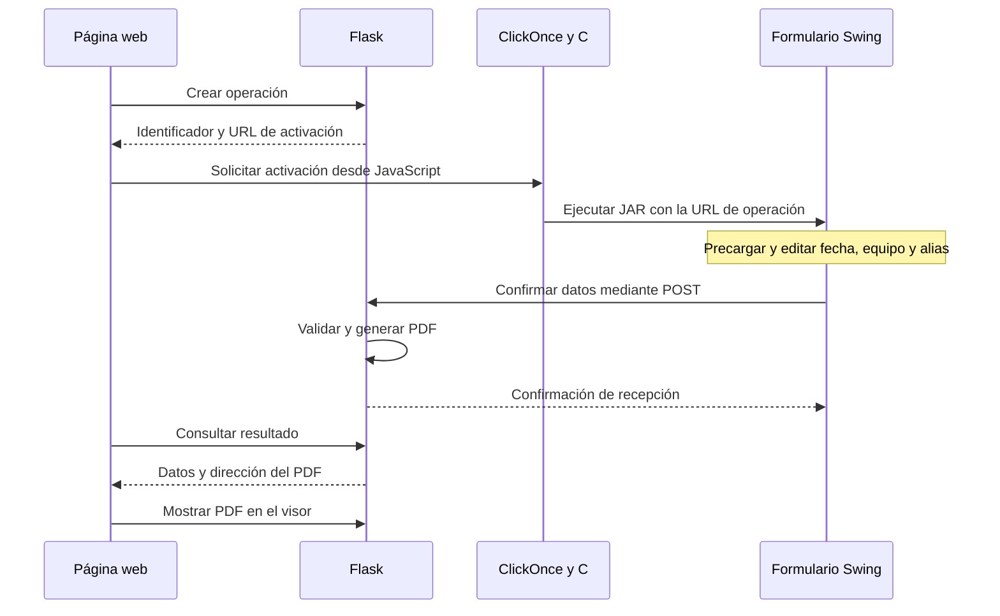

# Documentación técnica

[Volver al README](../README.md)

Las instrucciones de arranque y automatización están en el [README de la demo](../demo/README.md).

playwright-desktop integra Playwright Python con aplicaciones de escritorio invocadas desde una web mediante `page.expect_app()`, `DesktopContext`, `App`, `Window` y `Alert` acoplados al `BrowserContext`. `lib/` contiene la implementación Python y Rust. La demo `pc-info` reúne la web, el formulario Java y el lanzador ClickOnce en `demo/pc-info/`. Su automatización está en `demo/pc-info-automation/`.

## Responsabilidades

| Componente | Responsabilidad |
| --- | --- |
| Web Python | Crear operaciones, validar resultados, generar PDF y servir la publicación ClickOnce. |
| JavaScript | Solicitar la activación ClickOnce y consultar el resultado de la operación. |
| Lanzador C# | Leer los argumentos de activación y ejecutar el JAR con el runtime Java configurado. |
| Formulario Java | Precargar los datos del equipo, permitir su edición y devolverlos a la web. |
| Librería Python/Rust | Extender `Page` con `page.expect_app()`, asociar un `DesktopContext` por `BrowserContext`, aislar ventanas por sesión (`only_new`), detectar el idioma del SO (`os_language`) y usar Java Access Bridge o UI Automation según el proveedor disponible. |

## Flujo de la demo



La publicación utiliza parámetros URL de ClickOnce. El lanzador .NET Framework lee `ApplicationDeployment.CurrentDeployment.ActivationUri` y transmite la referencia de operación a Java. El navegador y el controlador ClickOnce del sistema realizan la activación. [Documentación de Microsoft](https://learn.microsoft.com/en-us/visualstudio/deployment/how-to-retrieve-query-string-information-in-an-online-clickonce-application?view=visualstudio)

## Contrato HTTP

| Método y ruta | Función |
| --- | --- |
| `POST /api/operations` | Crear una operación y obtener su URL ClickOnce. |
| `GET /api/operations/<id>` | Consultar estado, datos y URL del PDF. |
| `POST /api/operations/<id>/result` | Recibir `date`, `computerName` y `alias` como formulario UTF-8. |
| `POST /api/operations/<id>/cancel` | Comunicar la cancelación desde Java. |
| `POST /api/operations/<id>/error` | Comunicar un fallo de arranque del lanzador. |
| `GET /api/operations/<id>/document.pdf` | Obtener el PDF de una operación completada. |
| `GET /clickonce/<archivo>` | Servir los manifiestos y archivos de la aplicación. |

Las operaciones tienen estados `pending`, `completed`, `cancelled` y `failed`. Expiran a los veinte minutos desde su creación. Cada operación tiene un identificador aleatorio y conserva sus datos y PDF de forma independiente en memoria. Reiniciar el servidor elimina todas las operaciones.

Los envíos idénticos se pueden reintentar. Un resultado diferente para una operación ya finalizada devuelve conflicto. La generación del PDF y el cambio de estado se realizan juntos, de modo que un fallo de generación permite reintentar.

La fecha usa `YYYY-MM-DD`. El nombre del equipo y el alias admiten entre 1 y 100 caracteres visibles. El formulario Java realiza validación antes del envío y Flask valida nuevamente al recibirlo.

El almacén admite hasta cien operaciones vigentes. Una petición mayor de 64 KB devuelve `413`. Los errores de datos devuelven `422`, una operación desconocida `404`, una expirada `410`, los conflictos `409` y el límite de operaciones `429`. Crear una operación sin haber compilado la publicación devuelve `503`.

## Publicación y ejecución

El script de compilación utiliza `javac --release 11` y `jar` para producir el formulario. Compila el lanzador C# para .NET Framework 4.8 y arquitectura x64. Microsoft.DotNet.Mage genera los manifiestos ClickOnce con parámetros URL habilitados y calcula su versión a partir de la fecha UTC con resolución de dos segundos. [Herramientas y publicación ClickOnce](https://learn.microsoft.com/en-us/visualstudio/deployment/clickonce-security-and-deployment?view=visualstudio).

El lanzador se compila con `/nowin32manifest` para conservar la identidad de los manifiestos ClickOnce generados por Mage. La publicación de la demo se genera sin firma.

Dentro de `demo/pc-info/`, `start.ps1` prepara las dependencias Python, llama a `launcher-clickonce/build.ps1` y ejecuta Flask en primer plano, con el mismo puerto utilizado para la publicación. Si detecta el puerto ocupado, pregunta en terminal si debe liberar el proceso y termina con error cuando no se autoriza o falla el cierre. El servidor arranca sin recarga automática para mantener un único proceso que se detiene con `Ctrl+C`.

La dirección predeterminada es `http://127.0.0.1:18765`. El parámetro `-Port` de `start.ps1` configura conjuntamente la web y la publicación ClickOnce.

`launcher-clickonce/build.ps1` genera las clases y el JAR en `desktop-java/build/` y copia el JAR a la publicación de `launcher-clickonce/publish/`. Mage se instala en `launcher-clickonce/.tools/`. Flask sirve esa publicación mediante `/clickonce/`.

El script instala Mage con `dotnet tool install --allow-roll-forward`. [Compatibilidad de herramientas de .NET](https://learn.microsoft.com/dotnet/core/whats-new/dotnet-9/sdk#net-tool-roll-forward).

El lanzador obtiene la ruta de Java de su archivo de configuración. El formulario utiliza Swing y se comunica con el servidor HTTP de la demo en la interfaz de loopback.

### Automatización de la demo

La automatización usa el puerto predeterminado y configura `JAVA_HOME` con `playwright_desktop.configure(...)`. `run.py` comprueba que la demo responde y ejecuta CP-PI-01 dentro de `with page.expect_app(...) as opened:`, usando `opened.context` (`DesktopContext`) con `only_new=True` y `dcontext.os_language` para pulsar **Abrir** en Edge, confirmar el instalador ClickOnce o los avisos del sistema operativo antes de recibir la `App` del formulario Java y cerrar el flujo devolviendo el control al mismo `BrowserContext`.

CP-PI-02 comprueba el clic de apertura de forma independiente con el soporte nativo de Windows mediante `page.expect_app(...)`. Su Page Object localiza la ventana del navegador con `dcontext.app(pid=pid, title_prefix=...)` y cierra el diálogo capturado con `close()`.

### Navegador de la automatización

El fixture inicia Edge con un perfil temporal y pasa `--disable-sync` para evitar la sincronización con la cuenta Microsoft de Windows. Edge elige el puerto de depuración con `--remote-debugging-port=0`. El argumento `--edge-skip-compat-layer-relaunch` evita que un relanzamiento por compatibilidad interrumpa el arranque. El fixture cierra Edge y elimina el perfil al terminar. [Argumentos de Playwright para Chromium](https://github.com/microsoft/playwright/blob/main/packages/playwright-core/src/server/chromium/chromiumSwitches.ts).

Playwright se conecta mediante `connect_over_cdp(no_defaults=True)`. En `fixtures/browser.py`, `DOWNLOAD_BEHAVIOR = None` conserva el aviso nativo de ClickOnce. Para reproducir la bandeja de descargas, comenta esa asignación y descomenta `DOWNLOAD_BEHAVIOR = "default"`. El fixture envía `Browser.setDownloadBehavior` en esa variante. Al abrir la copia descargada se puede perder el parámetro `operation` que necesita el lanzador. [ClickOnce en Edge](https://learn.microsoft.com/en-us/deployedge/edge-learn-more-co-di) · [Parámetros de activación](https://learn.microsoft.com/en-us/visualstudio/deployment/how-to-retrieve-query-string-information-in-an-online-clickonce-application?view=visualstudio).

## Herramientas de desarrollo

### Desarrollo de la librería

La compilación requiere Python, Maturin, Rust MSVC y las herramientas C++ de Visual Studio. El comando se ejecuta desde la raíz del repositorio.

```powershell
.\lib\scripts\build_py.ps1
```

El script limpia `lib/rust/target/python/` y `lib/dist/python/` antes de ejecutar `maturin`. Si la limpieza falla, la compilación se detiene. El wheel y el paquete fuente (`.tar.gz`) quedan en `lib/dist/python/` e incluyen `playwright_desktop` y sus metadatos. `lib/README.md` aporta la descripción del paquete.

La compilación aplica el remapeo de rutas de Rust y Maturin elimina los símbolos de depuración. El SBOM automático de Rust está desactivado para evitar que el wheel incluya rutas de construcción. [Remapeo de rutas de Rust](https://doc.rust-lang.org/rustc/remap-source-paths.html).

Las pruebas de Rust se ejecutan con Cargo.

```powershell
cargo test --manifest-path lib/rust/Cargo.toml
```

Las pruebas internas de Python se ejecutan con `unittest`.

```powershell
py -m unittest discover -s lib/tests -v
```

### Herramientas del agente

Las skills de `.agents/skills/` apoyan el trabajo del agente y no son dependencias de ejecución de la demo. `skills-lock.json` registra sus fuentes y revisiones. Los directorios de compilación, publicación y herramientas descargadas se excluyen de Git mediante `.gitignore`.

## Criterios para la librería

- Reutilizar el código existente antes de extraer utilitarios.
- Centralizar el comportamiento compartido en el módulo responsable.
- Mantener los detalles de cada aplicación en su integración.
- Definir esperas por condiciones observables, tiempos límite y resultados claros.
- Asociar cada ventana y resultado con la operación que los inició.
- Separar las pruebas del contrato HTTP, la ejecución directa del lanzador y la activación real desde el navegador.
