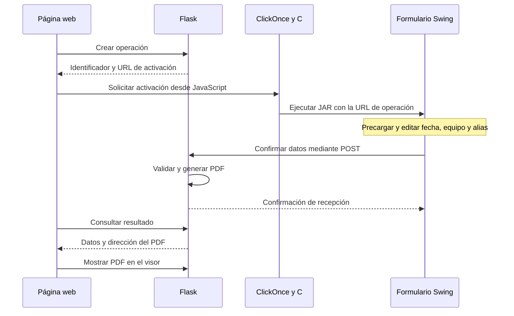

# Documentación técnica

[Volver al README](../README.md)

La preparación, ejecución y pruebas de las demos están en [demo/README.md](../demo/README.md).

playwright-desktop integra Playwright Python con aplicaciones de escritorio invocadas desde una web. `lib/` contiene la base Python/Rust de `page.desktop`. Cada demo tiene su propia carpeta dentro de `demo/`. El caso actual está en `demo/pc-info/`, con los componentes `web/`, `desktop-java/` y `launcher-clickonce/`; su automatización está en `demo/pc-info-automation/`.

## Responsabilidades

| Componente | Responsabilidad |
| --- | --- |
| Web Python | Crear operaciones, validar resultados, generar PDF y servir la publicación ClickOnce. |
| JavaScript | Solicitar la activación ClickOnce y consultar el resultado de la operación. |
| Lanzador C# | Leer los argumentos de activación y ejecutar el JAR con el runtime Java configurado. |
| Formulario Java | Precargar los datos del equipo, permitir su edición y devolverlos a la web. |
| Librería Python/Rust | Extender Page con `page.desktop` y ejecutar las acciones semánticas mediante Java Access Bridge. |

## Flujo de la demo



La publicación utiliza parámetros URL de ClickOnce. El lanzador .NET Framework lee `ApplicationDeployment.CurrentDeployment.ActivationUri` y transmite la referencia de operación a Java. El navegador y el controlador ClickOnce del sistema realizan la activación. [Documentación de Microsoft](https://learn.microsoft.com/en-us/visualstudio/deployment/how-to-retrieve-query-string-information-in-an-online-clickonce-application?view=visualstudio)

## Contrato HTTP local

| Método y ruta | Función |
| --- | --- |
| `POST /api/operations` | Crear una operación y obtener su URL ClickOnce. |
| `GET /api/operations/<id>` | Consultar estado, datos y URL del PDF. |
| `POST /api/operations/<id>/result` | Recibir `date`, `computerName` y `alias` como formulario UTF-8. |
| `POST /api/operations/<id>/cancel` | Comunicar la cancelación desde Java. |
| `POST /api/operations/<id>/error` | Comunicar un fallo de arranque del lanzador. |
| `GET /api/operations/<id>/document.pdf` | Obtener el PDF de una operación completada. |
| `GET /clickonce/<archivo>` | Servir los manifiestos y archivos de la aplicación. |

Las operaciones tienen estados `pending`, `completed`, `cancelled` y `failed`. Expiran a los veinte minutos desde su creación. Cada operación tiene un identificador aleatorio y conserva sus datos y PDF de forma independiente en memoria. Reiniciar el servidor elimina todas las operaciones.

Los envíos idénticos se pueden reintentar. Un resultado diferente para una operación ya finalizada devuelve conflicto. La generación del PDF y el cambio de estado se realizan juntos, de modo que un fallo de generación permite reintentar.

La fecha usa `YYYY-MM-DD`. El nombre del equipo y el alias admiten entre 1 y 100 caracteres visibles. El formulario Java realiza validación antes del envío y Flask valida nuevamente al recibirlo.

El almacén admite hasta cien operaciones vigentes. Una petición mayor de 64 KB devuelve `413`. Los errores de datos devuelven `422`, una operación desconocida `404`, una expirada `410`, los conflictos `409` y el límite de operaciones `429`. Crear una operación sin haber compilado la publicación devuelve `503`.

## Publicación y ejecución

El script de compilación utiliza `javac --release 11` y `jar` para producir el formulario. Compila el lanzador C# para .NET Framework 4.8 y arquitectura x64 con el compilador de Windows. Microsoft.DotNet.Mage 10.0.0 genera los manifiestos ClickOnce con parámetros URL habilitados y una versión por compilación, calculada a partir de la fecha UTC con resolución de dos segundos. [Herramientas y publicación ClickOnce](https://learn.microsoft.com/en-us/visualstudio/deployment/clickonce-security-and-deployment?view=visualstudio)

El lanzador se compila con `/nowin32manifest`. El manifiesto Win32 que `csc` incorpora por defecto identifica `MyApplication.app`, mientras que el ensamblado se llama `InformationDemo`. Esa diferencia provocaba `RefDefValidation` durante la descarga de ClickOnce, antes del arranque de Java. Se conservan los manifiestos externos de ClickOnce generados por Mage. [Caso documentado en el repositorio de Microsoft](https://github.com/microsoft/playwright-dotnet/issues/2874).

La publicación de esta demo local se genera sin firma. Las advertencias de firma del registro recibido no eran la causa de `RefDefValidation`.

Dentro de `demo/pc-info/`, `start.ps1` prepara las dependencias Python, llama a `launcher-clickonce/build.ps1` y ejecuta Flask en primer plano, con el mismo puerto utilizado para la publicación. Comprueba que el puerto esté disponible y detiene la preparación si falla un paso. El servidor arranca sin recarga automática para mantener un único proceso que se detiene con `Ctrl+C`.

La dirección predeterminada es `http://127.0.0.1:18765`. El parámetro `-Port` de `start.ps1` configura conjuntamente la web y la publicación ClickOnce.

La automatización usa la demo en ejecución en el puerto predeterminado. El escenario obtiene de la publicación ClickOnce el runtime que necesita Java Access Bridge y comprueba el recorrido desde el navegador hasta el PDF.

### Navegador de la automatización

Se intenta usar el navegador predeterminado de Windows si es compatible con Chromium para Playwright. Si el predeterminado no es compatible, se intenta usar Edge o Chrome instalados, en ese orden. Chrome y Edge tienen soporte oficial en Playwright. Otros navegadores Chromium dependen de su versión, y el Firefox instalado por el usuario requiere una versión adaptada para que Playwright lo controle. [Navegadores de Playwright](https://playwright.dev/python/docs/browsers).

Edge ofrece soporte nativo para ClickOnce. Para usar una extensión en otro navegador, abre un perfil de pruebas con `--user-data-dir` apuntando a la ruta que imprime la automatización. Instala allí la extensión de tu elección y cierra ese perfil antes de ejecutar `run.py`. Si ese perfil existe, se conserva para reutilizar la extensión. En los demás casos se usa un perfil temporal. [ClickOnce en Edge](https://learn.microsoft.com/en-us/deployedge/edge-learn-more-co-di) y [perfiles de pruebas de Playwright](https://playwright.dev/python/docs/api/class-browsertype#browser-type-launch-persistent-context).

`launcher-clickonce/build.ps1` genera las clases y el JAR en `desktop-java/build/` y copia el JAR a la publicación de `launcher-clickonce/publish/`. Mage se instala en `launcher-clickonce/.tools/`. Flask sirve esa publicación mediante `/clickonce/`.

La instalación de Mage utiliza `dotnet tool install --allow-roll-forward`, disponible desde el SDK de .NET 9, para permitir su ejecución en un runtime de .NET más reciente. [Compatibilidad de herramientas de .NET](https://learn.microsoft.com/dotnet/core/whats-new/dotnet-9/sdk#net-tool-roll-forward).

El lanzador obtiene la ruta Java de su archivo de configuración, distribuido con la publicación. El JAR utiliza Swing y las API estándar de Java 11. Los endpoints aceptados por los componentes nativos se limitan al servidor HTTP local de la demo.

## Herramientas de desarrollo

### Desarrollo de la librería

La instalación de usuario se documenta con `pip install playwright-desktop`. Para compilar se necesita Python global, Maturin, Rust MSVC y las herramientas C++ de Visual Studio. Desde la raíz:

```powershell
.\lib\scripts\build_py.ps1
```

El script elimina por completo `lib/rust/target/python/` y `lib/dist/python/` antes de ejecutar `maturin build`. Si la limpieza falla, la compilación se detiene. El wheel nuevo queda en `lib/dist/python/`. La limpieza afecta únicamente a Python. No instala dependencias ni ejecuta pruebas. Las pruebas Rust se ejecutan por separado:

```powershell
cargo test --manifest-path lib/rust/Cargo.toml
```

Las pruebas internas Python se ejecutan con:

```powershell
py -m unittest discover -s lib/tests -v
```

La versión [0.1.0 está publicada en PyPI](https://pypi.org/project/playwright-desktop/0.1.0/).

### Publicación en PyPI

Instala Twine una vez con `pip install twine`. Configura `MATURIN_PYPI_TOKEN` en el `.env` de la raíz y ejecuta:

```powershell
.\lib\scripts\publish_py.ps1
```

El script reutiliza `build_py.ps1` para compilar con Maturin y sube el wheel de `lib/dist/python/` mediante `twine upload`. Conserva el token existente en `.env` y restaura las variables de autenticación al terminar. `-WhatIf` muestra la acción sin ejecutarla. Los comandos `maturin publish` y `maturin upload` están [obsoletos](https://github.com/PyO3/maturin/issues/2334); Maturin se utiliza para la compilación. Para publicar cambios posteriores a `0.1.0`, incrementa la versión del paquete.

El wheel incluye el paquete `playwright_desktop` y sus metadatos. `lib/README.md` se incorpora como descripción de PyPI; los README del repositorio y de la demo no se empaquetan. Las dependencias PDF pertenecen a la demo, no al paquete publicado.

El build aplica el [remapeo de rutas de Rust](https://doc.rust-lang.org/rustc/remap-source-paths.html) para evitar incluir ubicaciones del proyecto y del caché Cargo. Maturin elimina símbolos de depuración y tiene desactivado el SBOM Rust automático porque contenía referencias locales. La revisión del wheel reconstruido comprobó sus archivos, metadatos, hashes y ausencia de rutas locales y credenciales; la importación fuera del repositorio y las 19 pruebas Python pasaron contra ese wheel.

Las salidas se separan por SDK; actualmente solo está implementado Python:

| SDK | Salida |
| --- | --- |
| Python | `lib/dist/python/` |
| JavaScript / TypeScript (Node.js) | `lib/dist/node/` |
| Java | `lib/dist/java/` |
| .NET | `lib/dist/dotnet/` |

### Herramientas del agente

Las skills de `.agents/skills/` apoyan el trabajo del agente y no son dependencias de ejecución de la demo. `skills-lock.json` registra sus fuentes y revisiones. Los directorios de compilación, publicación y herramientas descargadas se excluyen de Git mediante `.gitignore`.

## Criterios para la librería

- Reutilizar el código existente antes de extraer utilitarios.
- Centralizar el comportamiento compartido en el módulo responsable.
- Mantener los detalles de cada aplicación en su integración.
- Definir esperas por condiciones observables, tiempos límite y resultados claros.
- Asociar cada ventana y resultado con la operación que los inició.
- Separar las pruebas del contrato HTTP, la ejecución directa del lanzador y la activación real desde el navegador.
