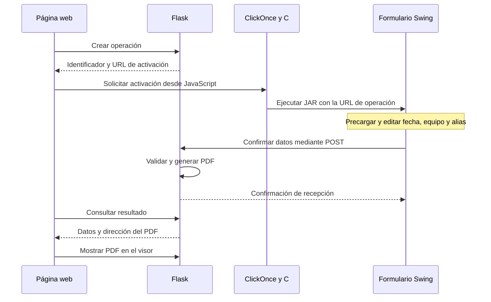

# Documentación técnica

[Volver al README](../README.md)

La preparación, ejecución y pruebas manuales de la demo están en su [README propio](../demo/informacion-equipo/README.md).

El objetivo de playwright-desktop es integrar Playwright Python con aplicaciones de escritorio invocadas desde una web. La implementación actual corresponde a la demo; `lib/` está reservada para la futura API reutilizable. Cada demo tiene su propia carpeta dentro de `demo/`. El caso actual está en `demo/informacion-equipo/`, con los componentes `web/`, `desktop-java/` y `launcher-clickonce/`.

## Responsabilidades

| Componente | Responsabilidad |
| --- | --- |
| Web Python | Crear operaciones, validar resultados, generar PDF y servir la publicación ClickOnce. |
| JavaScript | Solicitar la activación ClickOnce y consultar el resultado de la operación. |
| Lanzador C# | Leer los argumentos de activación y ejecutar el JAR con el runtime Java configurado. |
| Formulario Java | Precargar los datos del equipo, permitir su edición y devolverlos a la web. |
| Librería Python | Integrar las acciones web y de escritorio en una misma prueba. Su API queda pendiente de implementación. |

## Flujo de la demo

La publicación utiliza parámetros URL de ClickOnce. El lanzador .NET Framework lee `ApplicationDeployment.CurrentDeployment.ActivationUri` y transmite la referencia de operación a Java. El navegador y el controlador ClickOnce del sistema realizan la activación. [Documentación de Microsoft](https://learn.microsoft.com/en-us/visualstudio/deployment/how-to-retrieve-query-string-information-in-an-online-clickonce-application?view=visualstudio)

## Contrato HTTP local

| Método y ruta | Función |
| --- | --- |
| `POST /api/operations` | Crear una operación y obtener su URL ClickOnce. |
| `GET /api/operations/<id>` | Consultar estado, datos y URL del PDF. |
| `POST /api/operations/<id>/result` | Recibir `date`, `computerName` y `alias` como formulario UTF-8. |
| `POST /api/operations/<id>/cancel` | Comunicar la cancelación desde Java. |
| `POST /api/operations/<id>/error` | Comunicar un fallo de arranque del lanzador. |
| `GET /api/operations/<id>/document.pdf` | Obtener el PDF de una operación completada. |
| `GET /clickonce/<archivo>` | Servir los manifiestos y archivos de la aplicación. |

Las operaciones tienen estados `pending`, `completed`, `cancelled` y `failed`. Expiran a los veinte minutos desde su creación. Cada operación tiene un identificador aleatorio y conserva sus datos y PDF de forma independiente en memoria. Reiniciar el servidor elimina todas las operaciones.

Los envíos idénticos se pueden reintentar. Un resultado diferente para una operación ya finalizada devuelve conflicto. La generación del PDF y el cambio de estado se realizan juntos, de modo que un fallo de generación permite reintentar.

La fecha usa `YYYY-MM-DD`. El nombre del equipo y el alias admiten entre 1 y 100 caracteres visibles. El formulario Java realiza validación antes del envío y Flask valida nuevamente al recibirlo.

El almacén admite hasta cien operaciones vigentes. Una petición mayor de 64 KB devuelve `413`. Los errores de datos devuelven `422`, una operación desconocida `404`, una expirada `410`, los conflictos `409` y el límite de operaciones `429`. Crear una operación sin haber compilado la publicación devuelve `503`.

## Publicación y ejecución

El script de compilación utiliza `javac --release 11` y `jar` para producir el formulario. Compila el lanzador C# para .NET Framework 4.8 y arquitectura x64 con el compilador de Windows. Microsoft.DotNet.Mage 10.0.0 genera los manifiestos ClickOnce con parámetros URL habilitados y una versión por compilación, calculada a partir de la fecha UTC con resolución de dos segundos. [Herramientas y publicación ClickOnce](https://learn.microsoft.com/en-us/visualstudio/deployment/clickonce-security-and-deployment?view=visualstudio)

El lanzador se compila con `/nowin32manifest`. El manifiesto Win32 que `csc` incorpora por defecto identifica `MyApplication.app`, mientras que el ensamblado se llama `InformationDemo`. Esa diferencia provocaba `RefDefValidation` durante la descarga de ClickOnce, antes del arranque de Java. Se conservan los manifiestos externos de ClickOnce generados por Mage. [Caso documentado en el repositorio de Microsoft](https://github.com/microsoft/playwright-dotnet/issues/2874).

La publicación de esta demo local se genera sin firma. Las advertencias de firma del registro recibido no eran la causa de `RefDefValidation`.

Dentro de `demo/informacion-equipo/`, `start.ps1` prepara las dependencias Python, llama a `launcher-clickonce/build.ps1` y ejecuta Flask en primer plano, con el mismo puerto utilizado para la publicación. Comprueba que el puerto esté disponible y detiene la preparación si falla un paso. El servidor arranca sin recarga automática para mantener un único proceso que se detiene con `Ctrl+C`.

La dirección predeterminada es `http://127.0.0.1:18765`. El parámetro `-Port` de `start.ps1` configura conjuntamente la web y la publicación ClickOnce.

`launcher-clickonce/build.ps1` genera las clases y el JAR en `desktop-java/build/` y copia el JAR a la publicación de `launcher-clickonce/publish/`. Mage se instala en `launcher-clickonce/.tools/`. Flask sirve esa publicación mediante `/clickonce/`.

La instalación de Mage utiliza `dotnet tool install --allow-roll-forward`, disponible desde el SDK de .NET 9, para permitir su ejecución en un runtime de .NET más reciente. [Compatibilidad de herramientas de .NET](https://learn.microsoft.com/dotnet/core/whats-new/dotnet-9/sdk#net-tool-roll-forward).

El lanzador obtiene la ruta Java de su archivo de configuración, distribuido con la publicación. El JAR utiliza Swing y las API estándar de Java 11. Los endpoints aceptados por los componentes nativos se limitan al servidor HTTP local de la demo.

## Estado de verificación

| Comprobación | Estado |
| --- | --- |
| Contrato HTTP, aislamiento, concurrencia, validación, expiración y reintentos | Ocho pruebas de backend pasan. Incluyen generación de PDF y extracción de sus valores. |
| Orquestador y servidor HTTP | Arranque verificado, puerto configurable, publicación y URL de activación coherentes; parada con `Ctrl+C` comprobada. |
| Compilación Java y C# y generación de manifiestos | Verificadas; Java se compila con destino 11. |
| Corrección de `RefDefValidation` | Publicación recompilada y ausencia de la identidad Win32 conflictiva comprobada en el ejecutable. |
| Activación ClickOnce desde Edge | El registro recibido confirma que llegó a descargar y validar el ejecutable, donde falló antes de la corrección. Falta repetir la activación corregida. |
| Ejecución con OpenJDK, edición en Java, retorno a la web y vista previa del PDF | Pendientes de comprobar en un recorrido completo. |
| Librería de Playwright Python | Pendiente de implementación. |

Las pruebas del backend verifican el contenido textual del PDF. La revisión visual del PDF y las interacciones de escritorio siguen pendientes. La última comprobación visual automatizada se detuvo al no poder determinar la URL del navegador con suficiente certeza.

## Herramientas de desarrollo

Las skills de `.agents/skills/` apoyan el trabajo del agente y no son dependencias de ejecución de la demo. `skills-lock.json` registra sus fuentes y revisiones. Los directorios de compilación, publicación y herramientas descargadas se excluyen de Git mediante `.gitignore`.

## Criterios para la librería

- Reutilizar el código existente antes de extraer utilitarios.
- Centralizar el comportamiento compartido en el módulo responsable.
- Mantener los detalles de cada aplicación en su integración.
- Definir esperas por condiciones observables, tiempos límite y resultados claros.
- Asociar cada ventana y resultado con la operación que los inició.
- Separar las pruebas del contrato HTTP, la ejecución directa del lanzador y la activación real desde el navegador.

## Diseño de la librería

El usuario eligió extender el `Page` oficial mediante `page.desktop`. La [propuesta de arquitectura Python y Rust](superpowers/specs/2026-11-17-libreria-python-rust-design.md) define el monkey patch, el paquete mixto y un motor Windows con Java Access Bridge para Swing. El [plan de implementación](superpowers/plans/2026-11-17-libreria-python-rust.md) ordena su construcción y verificación. Ambos documentos corresponden al diseño; la librería aún no está implementada.

## Diseño y plan

- [Diseño aprobado](superpowers/specs/2026-11-17-demo-clickonce-java-design.md).
- [Plan de implementación](superpowers/plans/2026-11-17-demo-clickonce-java.md).
