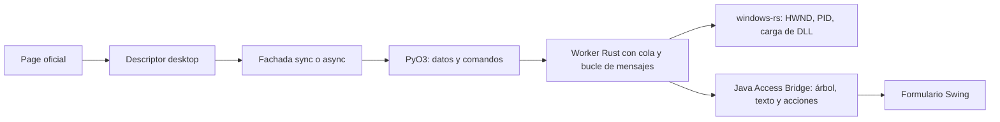

# playwright-desktop — arquitectura Python y Rust

El punto de entrada público es `page.desktop`. Las tareas y sus resultados se registran en el [plan de implementación](../plans/2026-11-17-libreria-python-rust.md).

## Objetivo y límites

Una importación de `playwright_desktop` amplía las clases públicas `Page` de Playwright Python. Los usuarios mantienen sus imports de Playwright, sus fixtures y sus instrucciones web. Las instancias creadas antes de importar la extensión también reciben el atributo añadido a su clase.

La primera versión controla el formulario Swing de la [demo existente](../../../demo/pc-info/), en Windows x64 y OpenJDK 11+. El motor es Rust, expuesto mediante PyO3. `windows-rs` proporciona las llamadas de Windows y Java Access Bridge proporciona acceso semántico a los controles Java.

El alcance inicial comprende localizar una ventana, seleccionar controles por rol y nombre accesible exactos, leer y reemplazar texto, invocar un botón y esperar el cierre de una ventana. Las pruebas de escritorio se ejecutan en serie en una sesión interactiva de Windows. La librería no implementará OCR, grabador, un lenguaje de selectores, entrada por coordenadas, un servicio HTTP local, control de instaladores ni una plataforma general de automatización.

## Enfoque y alternativas

El backend Java Access Bridge se integra en el proceso Python mediante Rust. `windows-rs` enumera ventanas, obtiene PID y título y carga las funciones de la DLL del bridge. Las llamadas JAB consultan y accionan los controles Swing. El runtime OpenJDK usado por la demo contiene `windowsaccessbridge-64.dll` y `jabswitch.exe`; la lectura, edición y confirmación en Java abierto directamente ya se comprobaron.

UI Automation de Windows es apropiado para controles que expongan su árbol UIA, pero no se asumirá que un formulario Swing ofrece ese árbol. Un backend UIA para otras aplicaciones queda fuera de la primera versión. Controlar teclado y coordenadas permitiría algunas acciones, pero no proporciona la búsqueda semántica requerida para verificar campos y botones. Introducir un agente dentro de Java exigiría modificar las aplicaciones bajo prueba.

Java Access Bridge es una dependencia del runtime Java, no un automatizador adicional. Debe estar disponible y habilitado antes de iniciar la aplicación Java. La librería diagnostica su ausencia; importar `playwright_desktop` no modifica la configuración de Java o Windows. [API JAB](https://docs.oracle.com/en/java/javase/11/access/java-access-bridge-api.html), [habilitación del bridge](https://docs.oracle.com/en/java/javase/25/access/enabling-and-testing-java-access-bridge.html).

## Estructura del proyecto

La raíz conserva `demo/`, `docs/` y `lib/`. Todo el paquete distribuible pertenece a `lib/`.

```text
lib/
  pyproject.toml                 Metadatos Python y backend Maturin
  README.md                      Instalación y contrato público
  python/playwright_desktop/
    __init__.py                  Exportaciones y aplicación automática del parche
    _patch.py                    Instalación, colisiones y desinstalación
    _sync.py                     Fachada síncrona de escritorio
    _async.py                    Fachada asíncrona de escritorio
    _models.py                   Consultas y validación compartida
    _errors.py                   Excepciones públicas y traducción de errores nativos
    _native.pyi                  Contrato tipado de la extensión compilada
    typing.py                    Protocols opcionales para consumidores con tipado estático
    py.typed
  rust/
    Cargo.toml
    Cargo.lock                   Dependencias transitivas reproducibles
    src/
      lib.rs                    Módulo PyO3 _native
      engine.rs                 Worker, comandos, plazos y ciclo de vida
      windows.rs                Descubrimiento y validación de ventanas y procesos
      jab/
        mod.rs                  Recorrido del árbol y acciones
        ffi.rs                  ABI, estructuras C y símbolos de JAB
        loader.rs               Carga y descarga de la DLL
      error.rs                  Errores internos independientes de Python
    tests/abi_layout.c          Sonda de ABI contra los headers del JDK, solo para pruebas
  tests/
    test_patch.py
    test_api.py
    test_async.py
  dist/                         Artefactos generados, excluidos de Git
    python/                     Wheels Python
    node/                       Salida futura JavaScript/TypeScript
    java/                       Salida futura Java
    dotnet/                     Salida futura .NET
demo/README.md                  Objetivo, contenido y ejecución de las demos
demo/pc-info-automation/
  models/                       DTO de fecha, equipo y alias
  config.py                     Dirección, plazo y runtime de la demo
  run.py                        Comando único del escenario funcional
  pages/                        Page Objects de web y formulario Java
  fixtures/                     Selección, preparación y limpieza del navegador
  utils/                        Lectura del texto del PDF
  tests/                        Escenario funcional y aserciones web/PDF
```

La separación corresponde a responsabilidades concretas. La lógica de selección y actuación pertenece a Rust; Python adapta la API y las excepciones. Los módulos sync y async comparten modelos y el mismo contrato nativo. No se creará una jerarquía de backends antes de necesitar una segunda implementación.

Cada build limpia únicamente sus artefactos. Python utiliza `dist/python/` y `rust/target/python/`; sus scripts no eliminan las carpetas de otros SDK.

La automatización de la demo sigue Page Object Model (POM) con un único escenario funcional. El test muestra la importación, la captura con `page.desktop.expect_window()` y las aserciones. El Page Object Java recibe la ventana capturada mediante `opened.value` y encapsula locators y acciones. La fixture prepara el runtime de Java. Se ejecuta con `py demo/pc-info-automation/run.py`, sin variables especiales ni descubrimiento manual. Las comprobaciones del motor y de concurrencia pertenecen a las pruebas de la librería.

Cada demo conserva su aplicación en `demo/<nombre>/` y todos los flujos que utilizan la librería en `demo/<nombre>-automation/`. Las pruebas internas de la librería pertenecen a `lib/tests/`.

## Configuración de distribución propuesta

`lib/pyproject.toml`:

```toml
[build-system]
requires = ["maturin>=1.16,<2"]
build-backend = "maturin"

[project]
name = "playwright-desktop"
version = "0.1.0"
description = "Desktop interactions for Playwright Python"
readme = "README.md"
requires-python = ">=3.10"
dependencies = ["playwright>=1.63,<1.66"]
classifiers = [
  "Operating System :: Microsoft :: Windows",
  "Programming Language :: Python :: 3",
  "Programming Language :: Rust",
]

[tool.maturin]
manifest-path = "rust/Cargo.toml"
python-source = "python"
module-name = "playwright_desktop._native"
bindings = "pyo3"
strip = true

[tool.maturin.sbom]
rust = false
```

`lib/rust/Cargo.toml`:

```toml
[package]
name = "playwright-desktop-native"
version = "0.1.0"
edition = "2024"
rust-version = "1.85"
publish = false

[lib]
name = "_native"
crate-type = ["cdylib", "rlib"]

[dependencies]
pyo3 = { version = "=0.30.1", features = ["abi3-py310"] }

[target.'cfg(windows)'.dependencies]
windows = { version = "=0.62.2", default-features = false, features = [
  "std",
  "Win32_Foundation",
  "Win32_System_LibraryLoader",
  "Win32_System_Threading",
  "Win32_UI_WindowsAndMessaging",
] }

[profile.release]
lto = "thin"
codegen-units = 1
```

Son las versiones base del diseño. La evidencia de compatibilidad se registra en el [plan de implementación](../plans/2026-11-17-libreria-python-rust.md#tarea-7--distribución-documentación-y-medidas). Una versión fuera del intervalo debe producir un diagnóstico claro y no un parche parcial.

Se usa Maturin para el wheel mixto y PyO3 con ABI estable para CPython convencional 3.10 a 3.14 en Windows x64. Los builds free-threaded, PyPy y otras plataformas quedan fuera de la matriz inicial. Los usuarios de un wheel precompilado no necesitan Rust; compilar desde fuentes requiere Rust MSVC y las herramientas C++ de Windows. Se conserva el uso de Python global mediante `pip install --user`, sin exigir un entorno virtual.

Las dependencias directas de ejecución son Playwright, PyO3 y `windows`; Maturin pertenece a la construcción y pypdf solo a las pruebas del PDF. Se utilizan `threading`, `weakref`, `asyncio`, canales, colecciones y temporizadores estándar. No se añaden Tokio, un framework desktop, JNI, JNA o una librería Python de automatización.

Referencias: [estructura mixta Maturin](https://www.maturin.rs/project_layout.html), [PyO3 y ABI estable](https://pyo3.rs/v0.30.1/building-and-distribution), [PyO3 0.30.1 y MSRV](https://github.com/PyO3/pyo3/blob/v0.30.1/Cargo.toml), [windows 0.62.2](https://docs.rs/crate/windows/0.62.2).

## API pública y unión con Playwright

Ejemplo propuesto, sobre una página y un navegador creados mediante Playwright oficial:

```python
import playwright_desktop
from playwright.sync_api import sync_playwright

with sync_playwright() as playwright:
    browser = playwright.chromium.launch(channel="msedge", headless=False)
    page = browser.new_page()
    page.desktop.configure(java_home="C:/ruta/openjdk")
    page.goto("http://127.0.0.1:18765")

    with page.desktop.expect_window(title="Información del equipo", timeout=15_000):
        page.get_by_role("button", name="Obtener información").click()

    page.desktop.get_by_role("textbox", name="Alias").fill("Prueba local")
    page.desktop.get_by_role("button", name="Confirmar").click()
    page.desktop.wait_for_closed(timeout=10_000)
    page.get_by_text("Información recibida. El PDF está listo.").wait_for()
    browser.close()
```

La variante async conserva los imports de `playwright.async_api`, utiliza `async with page.desktop.expect_window(...)` y `await` para las acciones nativas. `get_by_role()` construye una consulta local y no requiere `await`, igual que un locator web.

`configure()` y `set_default_timeout()` actualizan estado Python local y tampoco requieren `await`. El cierre explícito se escribe `page.desktop.close()` en sync y `await page.desktop.close()` en async. Salir de un contexto de captura por una excepción cancela la captura sin ocultar la excepción original del código web.

`page.desktop.window(title=..., pid=None)` permite adjuntarse a una ventana existente mediante una consulta diferida. Su primera acción espera una coincidencia única. `expect_window()` toma una instantánea antes del clic web, espera una ventana nueva y la asocia al `page.desktop` de esa página al salir del contexto. `get_by_role()` y `wait_for_closed()` usan el identificador nativo capturado y requieren una captura exitosa previa. El objeto devuelto por `as opened` conserva `.value` para quien necesite guardar una referencia explícita a la ventana. El timeout predeterminado es 10 000 ms y puede cambiarse con `page.desktop.set_default_timeout(ms)`. Cero hace una comprobación inmediata.

El MVP expone `get_by_role("textbox" | "button", name=...)`, `fill(text, timeout=...)`, `input_value(timeout=...)`, `click(timeout=...)` y `wait_for_closed(timeout=...)`. `input_value` y `fill` solo aplican a campos de texto; `click` solo a botones. La coincidencia es exacta, sensible a mayúsculas y basada en nombre accesible. Un rol no soportado se rechaza antes de llamar a Rust.

El parche utiliza las clases exportadas por `playwright.sync_api.Page` y `playwright.async_api.Page`, sin reemplazarlas ni utilizar `_impl`, greenlets privados o clases internas de Playwright. La implementación sigue estas reglas:

1. `__init__.py` llama a `install()` después de cargar las definiciones Python. No carga la DLL Java ni arranca un worker durante la importación.
2. `install()` comprueba la versión de Playwright y ambas clases bajo un lock. Usa inspección estática del atributo `desktop`, sin ejecutar descriptores ajenos.
3. Si un atributo ya pertenece a esta extensión y al mismo contrato de parche, la operación es idempotente. Si pertenece a otro componente, falla con `PatchConflictError` antes de modificar ninguna clase.
4. Se añade un descriptor a cada clase. Cada descriptor devuelve la fachada sync o async adecuada. Las instancias anteriores a la importación usan el mismo descriptor.
5. Un fallo durante la instalación revierte exclusivamente los atributos añadidos por esta llamada. No se sobrescriben `click`, `locator`, `goto`, constructores o métodos de cierre.
6. El descriptor conserva estado mediante referencias débiles por `Page`; sus valores no mantienen viva la página. El evento público `Page.on("close", ...)` solicita la liberación no bloqueante de la sesión Rust. La recolección de la página sirve como respaldo. `uninstall()` solo retira los descriptores que todavía son propios y no invalida sesiones obtenidas previamente; estas conservan su cierre explícito.
7. La primera operación de escritorio comprueba la plataforma, carga `_native` e inicializa el motor. Las acciones web conservan su comportamiento cuando Java no está disponible.

Esquema de unión, no código completo del instalador:

```python
# __init__.py
from ._patch import install, uninstall

install()

# _patch.py, después de validar ambas clases y comprobar colisiones:
setattr(SyncPage, "desktop", DesktopAccessor(mode="sync"))
setattr(AsyncPage, "desktop", DesktopAccessor(mode="async"))
```

El monkey patch funciona en tiempo de ejecución. Añadir un atributo a una clase ajena no hace que todos los analizadores estáticos lo reconozcan. Se distribuirán tipos del API propio y un `Protocol` opcional para quien quiera anotaciones y autocompletado; la ejecución no requiere casts o imports adicionales de tipos. Tampoco se afirmará que las acciones nativas aparecen automáticamente en Playwright Trace Viewer.

## Motor Rust para Windows y Java



### Carga, ABI y propiedad de recursos

El cliente especifica `page.desktop.configure(java_home=...)` antes del primer uso, o el motor utiliza `JAVA_HOME`. El diagnóstico debe distinguir ruta ausente, DLL inexistente, arquitectura incompatible, símbolo no disponible y bridge que no reconoce la ventana. Se carga una ruta absoluta mediante `LoadLibraryExW`, limitando la búsqueda de dependencias al directorio de la DLL y a los directorios seguros del sistema. No se distribuye una copia arbitraria de la DLL ni se busca una DLL por nombre en el directorio actual.

Existe un único motor JAB por proceso Python. Su ruta de DLL queda fijada al inicializarse; intentar usar otra ruta posteriormente produce `DesktopConfigurationError`. Los timeouts y las consultas pertenecen a cada fachada de `Page`. Cambiar de runtime del bridge requiere iniciar otro proceso de pruebas.

`ffi.rs` declara únicamente los tipos y símbolos usados, contrastados con los headers de OpenJDK 11. Los wrappers C de la documentación no deben confundirse con los símbolos que exporta la DLL: el cargador replica en Rust la inicialización mínima de `AccessBridgeCalls.c`, resuelve sus punteros y llama a `Windows_run`. El loop de mensajes permanece activo en el hilo propietario.

Las estructuras usan `#[repr(C)]`; UTF-16 usa unidades de 16 bits, `long` de Windows usa 32 bits y los objetos JAB de la arquitectura elegida usan 64 bits. Se comprueban tamaños, alineaciones y offsets contra los headers. Las conversiones de texto validan terminadores y capacidad, sin truncar silenciosamente.

Los objetos obtenidos de Java se liberan con `releaseJavaObject` en el hilo propietario mediante wrappers RAII. Python recibe identificadores opacos de sesión, ventana y consulta; nunca punteros ni referencias Java. La DLL permanece cargada mientras existan objetos o llamadas en curso. El cierre explícito de `page.desktop.close()` libera los recursos de esa sesión y no cierra la aplicación bajo prueba.

Base de ABI y símbolos: [AccessBridgePackages.h](https://raw.githubusercontent.com/openjdk/jdk11u/master/src/jdk.accessibility/windows/native/include/bridge/AccessBridgePackages.h), [AccessBridgeCalls.c](https://raw.githubusercontent.com/openjdk/jdk11u/master/src/jdk.accessibility/windows/native/bridge/AccessBridgeCalls.c). No es necesario compilar estos archivos C como dependencia del motor.

### Descubrimiento, selección y acciones

El motor enumera ventanas superiores visibles mediante `EnumWindows`, obtiene título y PID y filtra antes de consultar Java. Solo acepta una ventana JAB que coincida con el filtro. Cero coincidencias espera hasta el plazo; más de una produce un error de ambigüedad, sin escoger la primera.

Cada ventana se vincula al HWND, proceso y contexto raíz Java obtenidos al adjuntarse. Antes de cada acción se comprueba que continúa siendo la misma ventana. Las consultas se vuelven a resolver contra su árbol y no conservan indefinidamente objetos de controles que pueden haberse reemplazado. Los roles y estados se normalizan desde sus variantes inglesas del bridge.

El recorrido del árbol es iterativo y acotado por profundidad, cantidad de nodos y plazo. Debe informar de un límite alcanzado; no convertir una búsqueda incompleta en una selección aparentemente única. Se agrupan las propiedades disponibles en una sola consulta JAB para reducir viajes a la JVM.

`fill` exige un campo editable y habilitado, llama a `setTextContents` y comprueba el valor devuelto por una lectura posterior. El límite inicial del bridge es 1023 unidades UTF-16; se informa de excesos antes de invocarlo. `click` exige un botón disponible e invoca su acción accesible identificada, sin mover el ratón. Una acción no soportada genera un error explícito.

`expect_window()` facilita el caso de lanzamiento de la demo; no prueba por sí mismo que un proceso haya sido creado por una página determinada. El MVP admite un flujo desktop activo por proceso de pruebas y rechaza una segunda captura simultánea. La ejecución nativa debe ser serial también entre procesos de prueba que compartan el mismo escritorio. Si otra aplicación abre una ventana indistinguible durante una captura, se requiere un filtro adicional como PID o un título único. No se promete correlación automática para lanzamientos paralelos idénticos.

La reserva del flujo comienza al entrar en `expect_window()` y continúa después de salir de su contexto, mientras la ventana permanezca abierta. Adjuntarse con `window()` obtiene la misma reserva al resolver por primera vez su consulta. Se libera al observar el cierre de la ventana, al llamar a `page.desktop.close()` o al cerrarse la página. Un timeout o excepción antes de adjuntar la ventana también la libera. Salir del contexto tras una captura correcta no libera la reserva. En el MVP una sesión controla una sola ventana Java; los diálogos secundarios quedan fuera de su alcance inicial.

### Hilos, esperas y errores

Un worker Rust procesa los comandos y bombea mensajes Windows. Los objetos Java y los punteros de función permanecen en ese hilo. Las búsquedas pendientes se revisan por ciclos; no deben bloquear la cola durante todo su timeout.

Los bindings copian los argumentos Python a tipos Rust y utilizan `Python::detach` mientras esperan al motor. La fachada async utiliza `asyncio.to_thread` exclusivamente para llamadas al binding nativo; ningún objeto o método Playwright se ejecuta en ese hilo. Las instrucciones web siguen en su hilo o event loop originales. [Playwright y threading](https://playwright.dev/python/docs/library#threading), [PyO3 y separación del intérprete](https://pyo3.rs/v0.30.1/parallelism).

Los plazos se calculan con reloj monótono e incluyen el tiempo de cola. Antes de empezar una acción se comprueba su plazo y cancelación. Cancelar una coroutine invalida la solicitud y descarta respuestas tardías; no se reutiliza su consulta para otra página. Un timeout no repite automáticamente un clic cuyo resultado se desconoce.

Una llamada FFI que ya entró en una JVM bloqueada no se puede interrumpir con seguridad desde otro hilo. La versión en proceso ofrece plazos para colas y esperas, pero no garantiza cortar una llamada nativa colgada. Si una llamada FFI supera su plazo, se marca no utilizable el motor compartido completo, se rechazan comandos nuevos y se exige reiniciar el proceso Python. Liberar una reserva no recupera ese motor y no se descargan DLLs con llamadas en curso. Un proceso auxiliar para aislamiento y recuperación queda como evolución condicionada a evidencia, con coste y alcance propios.

Los errores públicos distinguen colisión del parche, plataforma no soportada, bridge no disponible, timeout, coincidencia ambigua, ventana obsoleta y acción fallida. Todos heredan de `DesktopError`; `DesktopTimeoutError` también será compatible con el `TimeoutError` público de Playwright. Rust devuelve códigos y contexto estructurado, y Python conserva la causa al traducirlos.

## Criterios de aceptación y rendimiento

- Los imports y métodos web conservan sus identidades y comportamiento antes y después del parche. No hay cambios de código dentro de Playwright instalado.
- Importar dos veces y recargar el paquete no duplica el parche ni inicia recursos nativos.
- Las APIs sync y async completan el mismo recorrido de la demo, con los tres valores editados y confirmados en el PDF.
- Los errores de bridge, las coincidencias múltiples, el cierre de una ventana y la cancelación async se verifican sin actuar sobre otra aplicación.
- El wheel se instala con Python global y se prueba fuera del árbol de fuentes.
- Se mide inicialización en frío, búsqueda, lectura, edición y acción en caliente, con percentiles p50/p95 y control de recursos tras recorridos repetidos. Se separa el tiempo del motor del arranque ClickOnce y de la generación del PDF.

Rust reduce el trabajo del adaptador y permite agrupar consultas, pero la comunicación JAB y la respuesta de Swing siguen siendo costes reales. No se declararán cifras de velocidad ni una garantía de ser más rápido sin mediciones.
