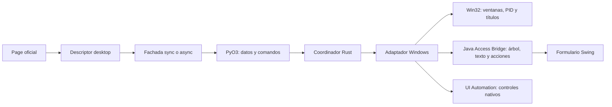

# playwright-desktop — arquitectura Python y Rust

El punto de entrada público es `page.desktop`. Las tareas y sus resultados se registran en el [plan de implementación](../plans/2026-11-17-libreria-python-rust.md).

## Objetivo y límites

Una importación de `playwright_desktop` amplía las clases públicas `Page` de Playwright Python. Los usuarios mantienen sus imports de Playwright, sus fixtures y sus instrucciones web. Las instancias creadas antes de importar la extensión también reciben el atributo añadido a su clase.

La implementación actual controla ventanas nativas y Swing en Windows x64. El motor Rust se expone mediante PyO3. El adaptador de Windows utiliza `windows-rs` para Win32 y UI Automation. Swing utiliza Java Access Bridge.

El alcance comprende localizar ventanas, seleccionar controles por rol y nombre accesible exactos, invocar acciones accesibles y esperar el cierre de una ventana. Java Access Bridge también permite leer y reemplazar texto en Swing. Las pruebas de escritorio se ejecutan en serie en una sesión interactiva de Windows.

## Proveedores en Windows

El adaptador de Windows usa `windows-rs` para enumerar ventanas y obtener su PID y título. Rust carga la DLL de Java Access Bridge para consultar y accionar controles Swing.

UI Automation permite accionar los controles nativos que exponen `InvokePattern`. Para Swing, Java Access Bridge permite acceder a los campos y botones expuestos por la JVM.

Java Access Bridge es una dependencia del runtime Java, no un automatizador adicional. Debe estar disponible y habilitado antes de iniciar la aplicación Java. La librería diagnostica su ausencia; importar `playwright_desktop` no modifica la configuración de Java o Windows. [API JAB](https://docs.oracle.com/en/java/javase/11/access/java-access-bridge-api.html), [habilitación del bridge](https://docs.oracle.com/en/java/javase/25/access/enabling-and-testing-java-access-bridge.html).

## Estructura del proyecto

La raíz conserva `demo/`, `docs/` y `lib/`. Todo el paquete distribuible pertenece a `lib/`.

```text
lib/
  pyproject.toml                 Metadatos Python y backend Maturin
  README.md                      Instalación y contrato público
  python/playwright_desktop/
    __init__.py                  Exportaciones y aplicación automática del parche
    _patch.py                    Instalación, colisiones y desinstalación
    _platform.py                 Compatibilidad del entorno
    _backend.py                  Carga del binding y configuración de Java
    _sync.py                     Fachada síncrona de escritorio
    _async.py                    Fachada asíncrona de escritorio
    _runtime.py                  Sesión por página y llamadas al motor
    _timing.py                   Plazos monotónicos de captura y solicitudes
    _models.py                   Consultas y validación compartida
    _errors.py                   Excepciones públicas y traducción de errores nativos
    _native.pyi                  Contrato tipado de la extensión compilada
    typing.py                    Protocols opcionales para consumidores con tipado estático
    py.typed
  rust/
    Cargo.toml
    Cargo.lock                   Dependencias transitivas reproducibles
    src/
      lib.rs                    Módulo PyO3 _native
      engine.rs                 Worker, comandos, plazos y ciclo de vida
      engine/platform.rs        Contrato Rust del adaptador
      engine/windows_platform.rs Adaptador de Windows y selección de proveedor
      backend.rs                Adaptador Windows con Java Access Bridge
      uia.rs                    Controles nativos mediante UI Automation
      windows.rs                Descubrimiento y validación de ventanas y procesos
      jab/
        mod.rs                  Recorrido del árbol y acciones
        ffi.rs                  ABI, estructuras C y símbolos de JAB
        loader.rs               Carga y descarga de la DLL
      error.rs                  Errores internos independientes de Python
    tests/abi_layout.c          Sonda de ABI contra los headers del JDK, solo para pruebas
  tests/
    test_patch.py
    test_api.py
    test_async.py
  dist/                         Artefactos generados, excluidos de Git
    python/                     Wheels Python
    node/                       Salida futura JavaScript/TypeScript
    java/                       Salida futura Java
    dotnet/                     Salida futura .NET
demo/README.md                  Objetivo, contenido y ejecución de las demos
demo/pc-info-automation/
  models/                       DTO de fecha, equipo y alias
  config.py                     Dirección, plazo y runtime de la demo
  run.py                        Ejecución de los casos funcionales
  run_local.ps1                 Ejecuta CP-PI-02 con el wheel local
  pages/                        Page Objects de web, Java y navegador
  fixtures/                     Selección, preparación y limpieza del navegador
  utils/                        Lectura del texto del PDF
  tests/                        Escenario funcional y aserciones web/PDF
```

Python expone `page.desktop` y asocia la sesión a una página de Playwright. El worker Rust gestiona plazos, solicitudes y reservas. El adaptador Rust descubre ventanas, conserva sus referencias nativas y ejecuta acciones. Los módulos sync y async comparten modelos y el contrato nativo.

## Extensión a otras aplicaciones y sistemas

Swing puede ejecutarse en distintos sistemas con su JVM. Java Access Bridge expone su accesibilidad externa mediante una DLL de Windows. En cada sistema se debe verificar que la aplicación publique los controles que prueba la librería. [Java Access Bridge](https://docs.oracle.com/en/java/javase/21/access/java-access-bridge-overview.html).

| Entorno | Acceso a los controles |
| --- | --- |
| Windows con Swing | Java Access Bridge. Motor actual. |
| Windows con controles nativos | UI Automation. Motor actual. [UI Automation](https://learn.microsoft.com/en-us/windows/win32/winauto/uiauto-uiautomationoverview). |
| macOS | Autorización de accesibilidad del proceso. [AXUIElement](https://developer.apple.com/documentation/applicationservices/axuielement_h?language=o_5). |
| Linux | Sesión con bus de accesibilidad. [AT-SPI sobre D-Bus](https://github.com/GNOME/at-spi2-core#accessibility-infrastructure). |

El motor selecciona JAB cuando el bridge reconoce la ventana y utiliza UI Automation para las demás. La configuración Java y el límite de texto pertenecen al adaptador JAB.

El contrato Rust separa el coordinador del adaptador de Windows. Cada adaptador traduce roles y acciones y conserva sus identificadores nativos y reglas de hilo. `Page.desktop` mantiene locators, plazos y errores comunes.

Cada build limpia únicamente sus artefactos. Python utiliza `dist/python/` y `rust/target/python/`; sus scripts no eliminan las carpetas de otros SDK.

La demo usa Page Object Model (POM). CP-PI-01 captura Java mediante `page.desktop.expect_window()` y comprueba los datos y el PDF. CP-PI-02 usa el wheel local para localizar la ventana del navegador por PID y prefijo de título y accionar el control de apertura. Las comprobaciones del motor y de concurrencia pertenecen a la librería.

Cada demo conserva su aplicación en `demo/<nombre>/` y todos los flujos que utilizan la librería en `demo/<nombre>-automation/`. Las pruebas internas de la librería pertenecen a `lib/tests/`.

## Configuración de distribución

El manifiesto Python declara Playwright como dependencia y configura Maturin para compilar el módulo `playwright_desktop._native`. El manifiesto Rust declara la ABI de PyO3 y las funcionalidades Win32 y UIA. [pyproject.toml](../../../lib/pyproject.toml), [Cargo.toml](../../../lib/rust/Cargo.toml).

La evidencia de compatibilidad se registra en el [plan de implementación](../plans/2026-11-17-libreria-python-rust.md#tarea-7--compatibilidad-rendimiento-y-revisión-final).

Se usa Maturin para el wheel mixto y PyO3 con ABI estable para CPython convencional 3.10 a 3.14 en Windows x64. Los builds free-threaded, PyPy y otras plataformas quedan fuera de la matriz inicial. Los usuarios de un wheel precompilado no necesitan Rust; compilar desde fuentes requiere Rust MSVC y las herramientas C++ de Windows. Se conserva el uso de Python global mediante `pip install --user`, sin exigir un entorno virtual.

El paquete Python depende de Playwright. El crate usa PyO3 y `windows`, Maturin construye el wheel y pypdf se usa en las pruebas del PDF de la demo.

Referencias: [estructura mixta Maturin](https://www.maturin.rs/project_layout.html), [PyO3 y ABI estable](https://pyo3.rs/v0.30.1/building-and-distribution), [PyO3 0.30.1 y MSRV](https://github.com/PyO3/pyo3/blob/v0.30.1/Cargo.toml), [windows 0.62.2](https://docs.rs/crate/windows/0.62.2).

## API pública y unión con Playwright

Ejemplo sobre una página de Playwright que ya está abierta.

```python
import playwright_desktop

with page.desktop.expect_window(title="Información del equipo") as opened:
    page.get_by_role("button", name="Obtener información").click()

window = opened.value
window.get_by_role("textbox", name="Alias").fill("QA")
window.get_by_role("button", name="Confirmar").click()
window.wait_for_closed()
```

La variante async conserva los imports de `playwright.async_api`, utiliza `async with page.desktop.expect_window(...)` y `await` para las acciones nativas. `get_by_role()` construye una consulta local y no requiere `await`, igual que un locator web.

`configure()` y `set_default_timeout()` actualizan estado Python local y tampoco requieren `await`. El cierre explícito se escribe `page.desktop.close()` en sync y `await page.desktop.close()` en async. Salir de un contexto de captura por una excepción cancela la captura sin ocultar la excepción original del código web.

`page.desktop.window()` identifica una ventana existente por `title`, `title_prefix` o `pid`. El PID se puede combinar con un filtro de título. Su primera acción espera una coincidencia única. `expect_window()` toma una instantánea antes del clic web, espera una ventana nueva y la asocia al `page.desktop` de esa página al salir del contexto. `get_by_role()` y `wait_for_closed()` usan el identificador nativo capturado y requieren una captura exitosa previa. El objeto devuelto por `as opened` conserva `.value`. El timeout predeterminado es 10 000 ms y puede cambiarse con `page.desktop.set_default_timeout(ms)`. Cero hace una comprobación inmediata.

JAB permite leer y editar campos de texto y accionar botones. UIA permite accionar botones, enlaces y opciones de menú y buscar esos controles dentro de un contenedor accesible. `get_by_role()` compara el nombre accesible exacto.

El parche utiliza las clases exportadas por `playwright.sync_api.Page` y `playwright.async_api.Page`, sin reemplazarlas ni utilizar `_impl`, greenlets privados o clases internas de Playwright. La implementación sigue estas reglas:

1. `__init__.py` llama a `install()` después de cargar las definiciones Python. No carga la DLL Java ni arranca un worker durante la importación.
2. `install()` comprueba la versión de Playwright y ambas clases bajo un lock. Usa inspección estática del atributo `desktop`, sin ejecutar descriptores ajenos.
3. Si un atributo ya pertenece a esta extensión y al mismo contrato de parche, la operación es idempotente. Si pertenece a otro componente, falla con `PatchConflictError` antes de modificar ninguna clase.
4. Se añade un descriptor a cada clase. Cada descriptor devuelve la fachada sync o async adecuada. Las instancias anteriores a la importación usan el mismo descriptor.
5. Un fallo durante la instalación revierte exclusivamente los atributos añadidos por esta llamada. No se sobrescriben `click`, `locator`, `goto`, constructores o métodos de cierre.
6. El descriptor conserva estado mediante referencias débiles por `Page`; sus valores no mantienen viva la página. El evento público `Page.on("close", ...)` solicita la liberación no bloqueante de la sesión Rust. La recolección de la página sirve como respaldo. `uninstall()` solo retira los descriptores que todavía son propios y no invalida sesiones obtenidas previamente; estas conservan su cierre explícito.
7. La primera operación de escritorio comprueba la plataforma, carga `_native` e inicializa el motor. Las acciones web conservan su comportamiento cuando Java no está disponible.

Esquema de unión, no código completo del instalador:

```python
# __init__.py
from ._patch import install, uninstall

install()

# _patch.py, después de validar ambas clases y comprobar colisiones:
setattr(SyncPage, "desktop", DesktopAccessor(mode="sync"))
setattr(AsyncPage, "desktop", DesktopAccessor(mode="async"))
```

El monkey patch funciona en tiempo de ejecución. Añadir un atributo a una clase ajena no hace que todos los analizadores estáticos lo reconozcan. Se distribuirán tipos del API propio y un `Protocol` opcional para quien quiera anotaciones y autocompletado; la ejecución no requiere casts o imports adicionales de tipos. Tampoco se afirmará que las acciones nativas aparecen automáticamente en Playwright Trace Viewer.

## Motor Rust para Windows y Java



### Carga, ABI y propiedad de recursos

El adaptador de Windows comprueba si el bridge reconoce la ventana. Para localizar la DLL reutiliza el runtime ya cargado o consulta `java_home` y `JAVA_HOME`. El diagnóstico distingue ruta ausente, DLL inexistente, arquitectura incompatible, símbolo no disponible y bridge que no reconoce la ventana. Se carga una ruta absoluta mediante `LoadLibraryExW`, limitando la búsqueda de dependencias al directorio de la DLL y a los directorios seguros del sistema.

Existe un único motor JAB por proceso Python. Su ruta de DLL queda fijada al inicializarse; intentar usar otra ruta posteriormente produce `DesktopConfigurationError`. Los timeouts y las consultas pertenecen a cada fachada de `Page`. Cambiar de runtime del bridge requiere iniciar otro proceso de pruebas.

`ffi.rs` declara únicamente los tipos y símbolos usados, contrastados con los headers de OpenJDK 11. Los wrappers C de la documentación no deben confundirse con los símbolos que exporta la DLL: el cargador replica en Rust la inicialización mínima de `AccessBridgeCalls.c`, resuelve sus punteros y llama a `Windows_run`. El loop de mensajes permanece activo en el hilo propietario.

Las estructuras usan `#[repr(C)]`; UTF-16 usa unidades de 16 bits, `long` de Windows usa 32 bits y los objetos JAB de la arquitectura elegida usan 64 bits. Se comprueban tamaños, alineaciones y offsets contra los headers. Las conversiones de texto validan terminadores y capacidad, sin truncar silenciosamente.

Los objetos obtenidos de Java se liberan con `releaseJavaObject` en el hilo propietario mediante wrappers RAII. Python recibe identificadores opacos de sesión, ventana y consulta; nunca punteros ni referencias Java. La DLL permanece cargada mientras existan objetos o llamadas en curso. El cierre explícito de `page.desktop.close()` libera los recursos de esa sesión y no cierra la aplicación bajo prueba.

Base de ABI y símbolos: [AccessBridgePackages.h](https://raw.githubusercontent.com/openjdk/jdk11u/master/src/jdk.accessibility/windows/native/include/bridge/AccessBridgePackages.h), [AccessBridgeCalls.c](https://raw.githubusercontent.com/openjdk/jdk11u/master/src/jdk.accessibility/windows/native/bridge/AccessBridgeCalls.c). No es necesario compilar estos archivos C como dependencia del motor.

### Descubrimiento, selección y acciones

El adaptador enumera ventanas superiores visibles mediante `EnumWindows` y aplica los filtros de título y PID. El coordinador espera hasta el plazo cuando hay cero coincidencias, reserva la ventana cuando hay una y comunica un error de ambigüedad cuando hay varias.

Cada ventana se vincula al HWND y al proceso. El proveedor conserva su referencia al árbol accesible y comprueba su identidad antes de cada acción. Los controles se vuelven a buscar en ese árbol al actuar.

El recorrido del árbol es iterativo y acotado por profundidad, cantidad de nodos y plazo. Debe informar de un límite alcanzado; no convertir una búsqueda incompleta en una selección aparentemente única. Se agrupan las propiedades disponibles en una sola consulta JAB para reducir viajes a la JVM.

En Swing, `fill()` exige un campo editable y habilitado, llama a `setTextContents` y comprueba el valor con una lectura posterior. JAB valida el límite de 1023 unidades UTF-16 antes de escribir. `click()` usa la acción accesible de Swing o `InvokePattern` en controles UIA habilitados. El proveedor devuelve un error explícito si el control no admite la acción.

`expect_window()` detecta una ventana nueva que cumple los filtros. El coordinador reserva el flujo de escritorio para una sesión por proceso de pruebas. Si varias ventanas coinciden durante una captura, la prueba debe precisar el PID o el título.

La reserva comienza al entrar en `expect_window()` o al resolver la consulta de `window()`. Una sesión puede manejar varias ventanas, como una ventana nativa y otra de Swing. El coordinador libera las referencias al cerrar la ventana, la sesión o la página.

### Hilos, esperas y errores

El coordinador procesa los comandos y cada proveedor conserva sus recursos en su propio hilo. JAB bombea mensajes de Windows y UIA mantiene su sesión COM.

Los bindings copian los argumentos Python a tipos Rust y utilizan `Python::detach` mientras esperan al motor. La fachada async utiliza `asyncio.to_thread` exclusivamente para llamadas al binding nativo; ningún objeto o método Playwright se ejecuta en ese hilo. Las instrucciones web siguen en su hilo o event loop originales. [Playwright y threading](https://playwright.dev/python/docs/library#threading), [PyO3 y separación del intérprete](https://pyo3.rs/v0.30.1/parallelism).

Los plazos incluyen el tiempo en cola. Justo antes de escribir o accionar un control se comprueba el plazo y la cancelación. Si la operación nativa ya pudo modificar el control, el timeout indica que el resultado es incierto.

Una llamada nativa bloqueada puede requerir reiniciar Python. Un bloqueo dentro de un proveedor lo deja fuera de servicio y los otros proveedores siguen disponibles. Un bloqueo del coordinador puede dejar fuera de servicio el motor compartido.

Los errores públicos distinguen colisión del parche, plataforma no soportada, bridge no disponible, timeout, coincidencia ambigua, ventana obsoleta y acción fallida. Todos heredan de `DesktopError`. `DesktopTimeoutError` también hereda del `TimeoutError` público de Playwright. Rust devuelve códigos y contexto estructurado, y Python conserva la causa al traducirlos.

## Criterios de aceptación y rendimiento

- Los imports y métodos web conservan sus identidades y comportamiento antes y después del parche. No hay cambios de código dentro de Playwright instalado.
- Importar dos veces y recargar el paquete no duplica el parche ni inicia recursos nativos.
- Las APIs sync y async completan el mismo recorrido de la demo, con los tres valores editados y confirmados en el PDF.
- Los errores de bridge, las coincidencias múltiples, el cierre de una ventana y la cancelación async se verifican sin actuar sobre otra aplicación.
- El wheel se instala con Python global y se prueba fuera del árbol de fuentes.
- Se mide inicialización en frío, búsqueda, lectura, edición y acción en caliente, con percentiles p50/p95 y control de recursos tras recorridos repetidos. Se separa el tiempo del motor del arranque ClickOnce y de la generación del PDF.

Rust reduce el trabajo del adaptador y permite agrupar consultas, pero la comunicación JAB y la respuesta de Swing siguen siendo costes reales. No se declararán cifras de velocidad ni una garantía de ser más rápido sin mediciones.
